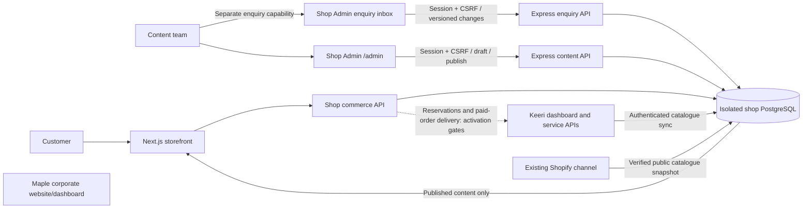
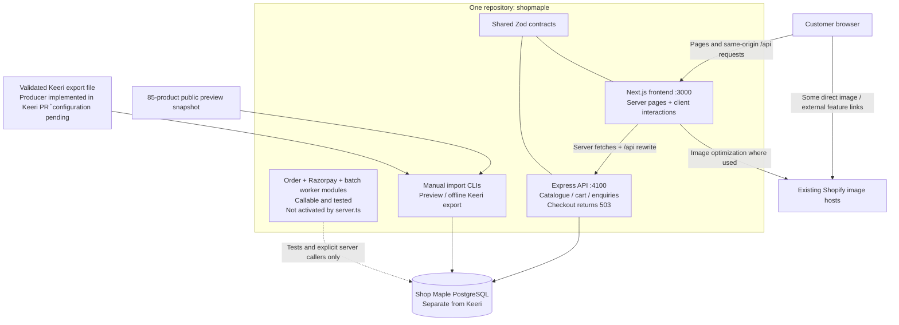
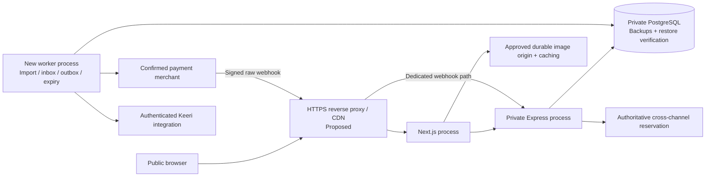

# Shop Maple architecture

Updated 26 October 2026. Shop Admin at `/admin` shares the shop repository and runtime. PR31 adds enquiry assignment/notes; PR32 adds deferred category films and smaller homepage client data. The homepage artwork/city controls increment is described in the current plan. Source and merged work must not be treated as deployed. Account activation still needs private publisher provisioning. Keeri remains the operational system of record. Checkout stays disabled.



| Surface | Owns | Does not own |
| --- | --- | --- |
| Shop Admin | Template copy/order/visibility, campaign scheduling, Instagram posts, pages/policies/blog copy, merchandising selections, artwork/private media and draft/publication/revisions; separately permitted customer enquiries | Product stock, invoices or delivery operations |
| Keeri | Products, channel publication, inventory, confirmed sales orders, invoices and fulfilment operations | Storefront layout and campaign editing |
| Maple corporate dashboard | Corporate website functions in its existing application | A second store order or inventory database |

Shop Admin is a separate staff interface in the existing infrastructure: Next.js serves it and Express enforces permissions. Content uses `ShopAdmin`, `ShopAdminSession`, `ShopContent`, immutable `ShopContentRevision` and `ShopMediaAsset`. Editors save drafts; publishers explicitly publish. Restoring a revision creates a new draft. Public rendering never queries draft content and falls back to checked-in source content when no valid publication exists.

Customer enquiries use their own permission, defaulting to denied even for content publishers. The existing inbox reads customer details and records internal review. The current ownership/notes increment adds assignment and append-only activity with the same enquiry version, separate from published site content. Staff credentials, notes and customer contact details never enter public content responses. Notes do not send customer replies; notification delivery and retention remain separate work.

Staff sessions use opaque HttpOnly cookies and hashed tokens, bounded lifetime, scrypt password hashes, login throttling, role checks and CSRF/origin checks. Concurrent edits use version checks. Content accepts bounded text and approved media/internal links, not executable HTML. The CLI creates the first publisher privately; there is no public signup. See [admin release and provisioning](admin-release.md).

Homepage artwork uses fixed placement identities and sparse overrides. The remaining Difference/value icons and city illustrations use the same approved-media, private-file and publication boundaries as banners and other template images. City-rail layout records the order and visibility of all 18 existing identities; hiding all entries removes that visual section. These are presentation controls and do not decide delivery areas, rates or stock. Legacy revisions without the new fields retain their original artwork and order. Editable image descriptions remain plain text; decorative originals may keep empty descriptions.

The deployed catalogue baseline before this increment is 539 products / 1,050 variants, combining Keeri and the Shopify snapshot. A scheduled Keeri pull updates the read model; unverified buyer prices remain “Price on request”. Product counts and runtime revisions must be rechecked during release, rather than treated as architecture guarantees.

Instagram uses a 24-post responsive native scroll rail, automatic advance and explicit pause/manual controls. Hover, keyboard interaction, background tabs and reduced-motion preferences suspend automatic movement. Gallery keyboard/swipe transitions and optional section reveals are implemented without a heavy animation dependency. Media upload, scheduling and fixed-template controls are implemented to the scope of their release notes; remaining media/authoring, enquiry workflows, measured performance, customer services and commerce activation remain in the [current work plan](superpowers/plans/2026-10-26-shop-content-motion.md).

---

## Historical implementation snapshot — 25 October 2026

The remainder records the earlier foundation and is not a current deployment/readiness claim. Later release records and the current work plan supersede its counts and integration status.

# Shop Maple architecture — historical foundation

Code inspected on 25 October 2026. This document describes the current implementation and the remaining production design separately. **The backend supports a local storefront preview; it is not ready to accept live orders.** Checkout is deliberately disabled, even when both applications are built in production mode.

The frontend and backend live in **one npm-workspace repository and run as separate processes**. There is no Medusa dependency. Keeri is the intended product and operational source; Shop Maple owns the customer shopping experience and online commerce state. The current catalogue is a dated Shopify preview snapshot containing **85 products and 115 variants**, not a live Keeri or Shopify inventory feed.

## 1. Components and boundaries

| Component | Current technology | Responsibility and status |
| --- | --- | --- |
| `apps/web` | Next.js 16.4.3, React 19.3.1, TypeScript | Server-rendered catalogue and content routes; interactive menus, product variants, favourites, cart and enquiry forms. Shopify layout/content references guide parity; full parity is ongoing. |
| `apps/api` | Node.js 22+, Express 5, Zod 4 | Public catalogue, guest cart, enquiry persistence, health endpoint and explicit checkout refusal. Opt-in checkout/status and raw webhook routes are tested with an injected order service; the running server does not inject it. |
| `packages/contracts` | Shared TypeScript and Zod schemas | Validates API input/output, product/cart/enquiry structures and catalogue imports across both applications. |
| Shop Maple database | PostgreSQL 17, Prisma 6.19.3 | Catalogue read model, guest carts, enquiries, sync cursor, frozen checkout attempts, payment-event inbox and Keeri outbox. This is separate from Keeri's database. |
| Catalogue tools | TypeScript CLI scripts | Manual public-preview import and validated offline Keeri export import. A bounded, authenticated export-fetch consumer exists for the proposed Keeri service contract; no live scheduler or configured producer is active. |
| Media and presentation | Next Image configuration, Shopify-hosted images, checked-in presentation JSON, local font packages | AVIF/WebP are enabled for optimized images. Existing remote image dependencies remain; no R2 migration or custom media pipeline is implemented. |
| Gateway module | Server-only Razorpay adapter | Order creation, signature validation and captured-payment verification with injected credentials/transport. Not constructed by the running server. Razorpay is supported by historical Shopify order evidence; the current merchant configuration still needs confirmation. |
| Verification | Node test runner/tsx, PostgreSQL test database, TypeScript, GitHub Actions | Automated API/component checks and both builds. Browser parity checks are manual. CI is verification, not deployment. |

### Current application connections

Solid connections below are wired in the application or available manual import commands. The isolated service block exists in source and tests; it is not a running background service.



Keeri is not in the live request path. Browsing reads the local product model; there is no browser access to Keeri admin APIs or either database.

## 2. Repository and frontend design

```text
apps/
  web/
    app/                  Next routes, layout and shared loading/error states
    components/           Header, product, collection, cart and enquiry UI
    lib/                  Server catalogue client and enquiry request client
    data/                 Landing content, collections and product presentation
    styles/               Page-specific Shopify parity styling
    test/                 React/client behavior tests
    next.config.ts        API rewrite, image allowlist and response headers
  api/
    src/app.ts            Exposed HTTP application
    src/server.ts         Runtime configuration and lifecycle
    src/catalog.ts        Published catalogue reads, filtering and sorting
    src/cart.ts           Guest credential, persistent cart and current totals
    src/enquiries.ts      Validated, idempotent enquiry persistence
    src/keeri*.ts          Offline export validation and transactional import
    src/orders/service.ts Durable checkout/event/outbox service
    src/payments/         Razorpay transport and verification adapter
    prisma/               Shop Maple schema and versioned migrations
    data/                 Public preview catalogue
    test/                 API, gateway and database integration tests
packages/contracts/       Shared runtime schemas and types
scripts/                  Manual catalogue import commands
docs/                     Integration contracts, status and architecture
.github/workflows/ci.yml  Automated verification
compose.yaml              Local PostgreSQL service
```

Current route families include `/`, `/collections/[handle]`, `/products/[handle]`, `/cart`, `/checkout`, `/favourites`, generic `/pages/[slug]`, and dedicated sofas, tables, chairs, Nimbus and Our Story pages. Some Shopify-owned features or destinations remain external links; route existence alone does not establish feature or visual parity.

Catalogue pages call the API from the server using `API_URL`, validate its response with shared contracts, and use a 30-second Next fetch revalidation window with a six-second timeout. The API advertises `public, max-age=30, s-maxage=60` for catalogue responses. There is no implemented publication-triggered cache invalidation or measured production CDN behavior.

Interactive cart state lives in `ShopProvider`, then persists through the API. Favourites are a browser-only list of product IDs in localStorage, not a customer account service. Enquiry inputs remain in form memory; the server persists accepted submissions. Public routes have preview/noindex metadata and headers, and the layout displays the checkout-unavailable notice.

The current API loads matching catalogue rows before sorting and slicing results. This is bounded preview behavior, not a full-catalogue search architecture. Move sorting/pagination into indexed database queries and profile actual catalogue size before scaling.

## 3. Public API that exists today

Browser requests use Next's `/api/:path*` rewrite; there are no Next route handlers for these endpoints. The rewrite destination is configured at build time, so changing `API_URL` requires rebuilding the frontend.

| Method and path | Current behavior | Boundary |
| --- | --- | --- |
| `GET /api/health` | Checks PostgreSQL with `SELECT 1`; returns status, preview mode and `checkoutEnabled: false`. | Database reachability, not integration readiness. |
| `GET /api/products` | Published products/variants; optional query/category/sort/page/limit. Maximum page size 50. | Public cacheable read model. |
| `GET /api/products/:handle` | One published product or 404. | Public cacheable read model. |
| `GET /api/cart` | Guest's persisted cart or an empty cart. | Opaque cookie; private/no-store. |
| `PUT /api/cart/items/:variantId` | Sets absolute quantity 0–20; maximum 50 distinct lines; server reads prices. | Configured Origin required; private/no-store. |
| `POST /api/enquiries` | Validates and saves contact, bulk or project enquiry; requires UUID `Idempotency-Key`. Returns 201 or 200 for replay. | Origin check, body/rate limits, private/no-store. Returns `notificationSent: false`. |
| `POST /api/checkout` | Always returns 503 `CHECKOUT_NOT_AVAILABLE`. | No provider call or order created through this endpoint. |

The running preview server exposes no order-status or gateway-webhook route. An optional injected service adds checkout creation, provider-order creation, owned status and exact-byte signed webhook intake in tests; see [checkout HTTP boundary](checkout-http.md). Refund, customer-login and staff-enquiry endpoints remain absent. There is no public enquiry read endpoint.

## 4. Data ownership and persistence

| Data | System of record / current storage | Rules |
| --- | --- | --- |
| Product identity, approved publication, MRP, media, operational stock | Intended: Keeri. Current preview: dated public Shopify snapshot. | Do not infer stock reservations from catalogue availability. Public handles/categories and media URLs require reviewed mappings for Keeri. |
| Public catalogue | Shop Maple `Product`, `Variant` | Read model with source identity, publication and source timestamp. Prices are integer paise; public currency is INR. |
| Import progress | `CatalogueSyncState` | Tenant source, capture timestamp and validated-payload digest; detects stale or conflicting snapshots. |
| Guest cart | `Cart`, `CartItem` | Database holds SHA-256 of a 32-byte random guest token; cookie expires after 30 days. Cart uses current catalogue prices. |
| Enquiry | `Enquiry` | Validated contact/context data plus hashed idempotency key and payload digest. No team notification or staff workflow yet. |
| Logical online order | `CheckoutAttempt` | Frozen items, quantities, prices, charges, policy ID, merchant scope, reservation, gateway IDs and state. There is not yet a separate complete customer/fulfilment order model. |
| Payment-event acceptance | `PaymentWebhookInbox` | Authenticated event metadata and body digest, not raw payment payload/signature. Unique per merchant/event and merchant/digest. |
| Intended Keeri handoff | `OrderOutbox` | Unique attempt/kind and frozen capture payload. Pending record proves delivery intent, not delivery to Keeri. |
| Payment instrument and provider payment status | Gateway | Server verifies captured evidence. The application does not collect card credentials. |
| Sales operations, invoices and fulfilment | Intended: Keeri | Delivery, reservation consumption and acknowledgement are not implemented. |

```mermaid
erDiagram
  Product ||--o{ Variant : contains
  Variant ||--o{ CartItem : referenced_by
  Cart ||--o{ CartItem : contains
  Cart ||..o{ CheckoutAttempt : "logical cartId reference"
  CheckoutAttempt ||..o{ PaymentWebhookInbox : "merchant and provider ID lookup"
  CheckoutAttempt ||..o{ OrderOutbox : "logical attemptId reference"
  Product {
    string id PK
    string handle UK
    string source
    boolean published
  }
  Variant {
    string id PK
    string productId FK
    int pricePaise
    string stockPolicy
    boolean available
  }
  Cart {
    string id PK
    string tokenHash UK
    datetime expiresAt
  }
  CartItem {
    string cartId PK,FK
    string variantId PK,FK
    int quantity
  }
  CheckoutAttempt {
    string id PK
    string cartId
    string merchantScope
    json snapshot
    int amountPaise
    string state
    string reservationId UK
    string providerOrderId UK
    string paymentId UK
  }
  PaymentWebhookInbox {
    string id PK
    string merchantScope
    string eventId
    string bodySha256
    string state
  }
  OrderOutbox {
    string id PK
    string attemptId
    string kind
    json payload
    string state
  }
  CatalogueSyncState {
    string source PK
    datetime capturedAt
    string payloadHash
  }
  Enquiry {
    string id PK
    string idempotencyHash UK
    string payloadHash
    json context
    string status
  }
```



Dashed relationships are application-level references, not Prisma foreign keys. Checkout snapshots retain their commercial facts independently of later catalogue/cart changes. Cart items restrict variant deletion; import retirement preserves referenced records.

### Catalogue publication flow

Current manual paths:

1. `scripts/import-preview.ts` validates the checked-in Shopify preview snapshot and writes only the preview source/identity namespace. It refuses production mode.
2. `scripts/import-keeri.ts` validates a supplied full tenant export. Dry run makes no network/database write. Apply is restricted to designated local Shop Maple databases and refuses production mode.
3. Keeri import checks tenant/identity ownership, publication, MRP and approved public media; it serializes tenant imports with a transaction advisory lock and atomically updates the cursor/read model. Older/conflicting snapshots fail; identical snapshots are replay-safe. Omitted source records are retired.
4. **All Keeri-imported variants remain unavailable for purchase** until inventory guarantees exist. Preview-source handle collisions require an explicit cutover mapping; imports cannot silently take over another source's identity.

Target: authenticated consistent Keeri export producer → scheduled import → local catalogue → cache invalidation/freshness monitoring. The producer is implemented in Keeri PR #778; deployment, reviewed publication/media manifest, service credential, schedule, invalidation and source cutover are still required. See [Keeri integration](keeri-integration.md).

## 5. Order and payment architecture

The order module already implements durable service methods, but the running API never constructs it. It needs server-owned gateway configuration, a verified reservation adapter and a real pricing policy. Tests inject those dependencies; test doubles are not production integrations.

The sequence below is the **activation design**. Service methods, opt-in HTTP boundaries and leased batch processors exist. Running-server activation, hosted browser checkout, production reservation transport and Keeri delivery remain pending.

```mermaid
sequenceDiagram
  participant B as Browser
  participant A as Opt-in checkout HTTP layer
  participant O as Existing order service
  participant D as PostgreSQL
  participant S as Required stock reservation service
  participant P as Razorpay merchant
  participant W as Leased inbox/outbox batch workers
  participant K as Keeri
  B->>A: Cart credential + idempotency key + required customer data
  A->>O: freezeCart(guestToken, key)
  O->>D: Authenticate guest; persist immutable priced snapshot
  A->>O: createProviderOrder(guestToken, attemptId)
  O->>D: Claim attempt once
  O->>S: Reserve exact snapshot across sales channels
  S-->>O: Verified durable binding and expiry
  O->>D: Persist reservation guarantee
  O->>P: Create order with frozen amount and receipt
  O->>D: Persist provider order identity
  A-->>B: Hosted checkout configuration
  B->>P: Complete provider-hosted payment
  P->>A: Raw signed webhook
  A->>O: ingestWebhook(raw bytes, signature, event ID)
  O->>D: Persist authenticated deduplicated inbox record
  A-->>P: Acknowledge only after durable acceptance
  W->>O: processWebhook(inboxId)
  O->>S: Verify reservation binding and expiry
  O->>P: Fetch current captured payment evidence
  O->>D: One transaction: captured + inbox processed + outbox
  W->>K: Idempotent handoff and reservation consumption
  K-->>W: Durable acknowledgement
  W->>D: Record delivery outcome
```

The final two delivery steps require the real Keeri transport and verified acknowledgement contract. The outbox now has atomic claims, lease fencing, crash recovery, bounded retries, failure state and acknowledgement validation, but no auto-running scheduler or operator recovery UI; see [workers](order-workers.md). The frozen snapshot currently has no shipping address, customer contact or complete fulfilment fields; those must be validated and designed before the HTTP layer is enabled.

### Existing correctness guarantees

- `freezeCart` uses an unexpired guest token, current database prices and a trusted pricing function. Repeat keys on the same cart return the original snapshot. Charges, totals and line values must fit the PostgreSQL integer range; currency is INR.
- Only published, available `stocked` variants qualify for the order service. Preview cart acceptance of an `unverified` item does not make it checkout eligible.
- Reservation identity binds the attempt and canonical snapshot digest to an expiry. There is no production implementation of that contract.
- A conditional claim prevents concurrent calls from creating multiple provider orders. Ambiguous provider creation or a lost persistence result requires reconciliation; it is not automatically retried with a new receipt.
- Webhook authentication verifies original bytes before parsing. The inbox deduplicates both merchant/event ID and merchant/body digest. A signed event is a lookup hint, not authority to fulfil.
- Capture processing fetches payment evidence and checks provider order, payment identity, exact amount/currency, captured status, absence of refunds and a valid reservation. Unresolved cases remain reconciliation work.
- One serializable transaction records capture, inbox completion and the unique Keeri handoff intent. Database failures roll back the transition.

Normal attempt path: `reservation_required → reserving → creating_provider_order → awaiting_payment → captured`. Failed or uncertain external operations use `reconciliation_required`; crashes may leave an intermediate state requiring operator recovery. Cancellation/refund/dispute transitions, reservation release, late-payment recovery and recovery tooling are not complete. A browser success redirect must never mark an order paid.

See [order flow](order-flow.md) and [gateway boundary](payments.md) for exact method contracts and tested cases.

## 6. Security and runtime boundaries

Implemented controls include strict shared validation, bounded inputs, Helmet headers, general API rate limiting, no-store cart/enquiry/checkout responses, sanitized API errors and Origin validation for writes. The guest cookie is HttpOnly, SameSite=Lax and Secure in production. The browser never receives the database URL or gateway secret through this design.

Important deployment work remains:

- Enforce HTTPS and a known trusted proxy chain. Current rate limiting is process-local and uses the direct connection IP; the Next proxy may aggregate customers into one IP. Configure shared limits and trusted forwarding deliberately.
- Add authenticated staff access, retention/deletion and notification delivery before collecting real enquiry data. Existing preview receipts explicitly say no notification was sent.
- Place any future raw-webhook route before general JSON parsing, apply its own body/signature limits, and bind the endpoint secret to the same merchant and environment as API credentials. The current generic Origin gate is intended for browser writes; a gateway webhook needs its separately authenticated routing boundary.
- Keep database, Keeri and gateway secrets in server-side deployment configuration. Establish rotation and least-privilege access. No unattended Keeri credential is configured.
- Add operational auditing, expiry cleanup, recovery tooling and alerts. Generic console errors and a database health endpoint are not full observability.

## 7. Proposed production topology — not deployed by this repository

Start with two application processes plus a worker process and a separate PostgreSQL database. They can be deployed together on one appropriately sized host initially; keeping process boundaries allows later separation without splitting the repository. A managed PostgreSQL service is also possible. Hosting, sizing and public routing have not been finalized here.



This diagram proposes capabilities, not a claim that a CDN, worker fleet, object store or queue has been provisioned. Redis, Cloudflare R2 and a particular hosting vendor are **not prerequisites or implemented infrastructure**. PostgreSQL can hold durable work for the initial deployment; batch processors implement claiming/retries; process scheduling, visibility and alerting remain required.

Production requires migration execution, process supervision, health/readiness checks, TLS, secrets, backup retention and restore testing, logs/metrics, error alerts and rollback procedures. Catalogue freshness, stuck checkout attempts, unprocessed inbox events, undelivered outbox entries and expiring reservations need explicit monitoring. Preserve current Shopify operation until sandbox/end-to-end tests and a reversible domain cutover are approved and verified.

## 8. Backend readiness and release gates

| Capability | Ready now? | Evidence boundary / remaining work |
| --- | --- | --- |
| Public catalogue and guest cart | **Yes, for preview** | Implemented HTTP endpoints and database tests. Source is a dated snapshot; no authoritative stock guarantee. |
| Enquiry persistence | **Yes, for preview** | Idempotent storage and honest receipt. Staff inbox, notifications, privacy lifecycle and production abuse controls remain. |
| Offline Keeri transformation/import | **Yes, locally** | Validated schema, tenant isolation, replay/staleness and transactional import. Fetch consumer and Keeri producer code exist; configured transport and deployment validation remain. |
| Frozen orders and payment-event persistence | **Service foundation ready** | Callable and database-tested; no public activation or complete customer/fulfilment flow. |
| Razorpay adapter | **Boundary tested** | Deterministic fixtures/mock transport. Current merchant, test/live mode, capture settings and real sandbox flow are unverified. |
| Inventory reservation | **No** | Interface and fail-closed gate exist; no cross-channel stock adapter or last-item production proof. |
| Public checkout and payment callbacks/webhooks | **Tested opt-in boundary only** | Running checkout returns 503. Injection enables tested routes; hosted browser checkout and live activation remain pending. |
| Keeri order delivery | **Worker boundary tested** | Leased delivery, retry and bound acknowledgement checks exist; the real transport and complete commercial handoff are not active. |
| Refunds, disputes, cancellation and support recovery | **No** | Reconciliation boundaries exist, not a complete operational workflow. |
| Deployment and production performance | **No release evidence here** | CI builds/tests; no deployment pipeline, measured live Core Web Vitals or production restore test. |

Suggested activation order:

1. Confirm current gateway merchant/mode and business rules for shipping, tax, serviceability, purchase versus enquiry, and required customer/order data.
2. Implement authenticated Keeri catalogue publication and authoritative reservation/expiry/consumption across online and offline sales.
3. Activate the tested checkout/status and authenticated raw-webhook boundaries only with verified server dependencies; implement hosted checkout and required customer data.
4. Implement inbox scheduling, ambiguous-creation recovery, Keeri outbox delivery/acknowledgement, notifications and operational retries/alerts.
5. Complete refund/dispute/cancellation handling and validate provider sandbox, last-item contention, duplicate/out-of-order events, delayed capture and failed handoff recovery end to end.
6. Verify deployment, restore/rollback, media/URL migration, browser parity and measured performance before a live cutover. Remove preview/noindex only as part of that controlled release.

The earlier targets of LCP ≤2.5s, CLS ≤0.1 and INP ≤200ms are acceptance targets, not current measurements. Matching screenshots also does not establish interactive parity; menu, keyboard, mobile, cart, account and app behavior require their own verification.

## 9. Source map and verification

This architecture was checked against:

- [Workspace commands](../package.json), [frontend package](../apps/web/package.json), [API package](../apps/api/package.json).
- [Runtime and mode gate](../apps/api/src/server.ts), [actual HTTP routes](../apps/api/src/app.ts), [database schema](../apps/api/prisma/schema.prisma).
- [Server catalogue client](../apps/web/lib/catalog.ts), [API proxy/image settings](../apps/web/next.config.ts), [browser shop state](../apps/web/components/shop-provider.tsx).
- [Catalogue queries](../apps/api/src/catalog.ts), [cart](../apps/api/src/cart.ts), [enquiries](../apps/api/src/enquiries.ts), [offline Keeri adapter](../apps/api/src/keeri.ts), [transactional sync](../apps/api/src/keeri-sync.ts).
- [Order service](../apps/api/src/orders/service.ts), [Razorpay adapter](../apps/api/src/payments/razorpay.ts), [CI workflow](../.github/workflows/ci.yml).
- [Preview snapshot](../apps/api/data/preview-catalog.json), [landing content provenance](../apps/web/data/landing-PROVENANCE.md), [UI parity status](ui-parity-progress.md).

CI installs dependencies on Node 22, starts PostgreSQL 17, creates/migrates a dedicated test database, imports the preview, runs tests/typechecks and builds both apps. The prior merged checkpoint passed 74 tests; current integration results are recorded in the PR and roadmap, not proof of merchant/Keeri integration. Check the latest commit's CI before merging. Manual browser checks and production integration checks remain distinct from unit/integration test success.


## 10. Dedicated Keeri service boundary

[Keeri PR #778](https://github.com/maple-studios-co-in/Keeri/pull/778) implements the producer and stock side in the separate Keeri repository. These endpoints have no live configuration in this project:

| Endpoint | Authority and responsibility |
| --- | --- |
| `GET /api/storefront/catalogue` | Scoped bearer credential; consistent tenant snapshot with reviewed public publication/media mapping and MRP-only prices. No private media keys or admin sessions. |
| `POST /api/storefront/reservations` | Freeze-bound, idempotent stock hold under shared inventory locks. The service derives tenant/product/variant quantities from the snapshot. |
| `POST /api/storefront/reservations/verify` | Check exact reservation/attempt/digest binding, live expiry and physical stock backing. |
| `POST /api/storefront/reservations/release` | Release only the bound unpaid hold. Paid holds require commercial reconciliation. |
| `POST /api/storefront/orders` | Idempotent captured-order intake bound to merchant, attempt, reservation and payload digest; returns a distinct intake receipt. |

Credentials are hashed, expiring and scoped to a configured tenant and merchant. Exact route/method exemptions in Keeri's Next proxy delegate authentication to these handlers; all adjacent routes retain their existing session gate. Missing configuration fails closed. Deployment must supply HTTPS, ingress limits and a verified environment reload/credential-rotation procedure.

The intake enters `pending_commercial_review`, retaining its stock as `paid_pending_review`. It does not create a SalesOrder, invent a customer/address, or return ShopMaple's required `externalOrderId`. Consequently, the ShopMaple order delivery adapter remains disconnected until the commercial handoff is completed or its protocol explicitly distinguishes intake from sales-order creation. Paid holds must not expire automatically while that handoff is unresolved.

Keeri's quotation issuance now checks finite stocked-item availability under the shared row locks used by storefront holds. Made-to-order quotation semantics are retained. Real database contention, replay, cross-tenant and lifecycle tests cover the implemented paths; this does not prove all production stock policies or operational recovery flows.
